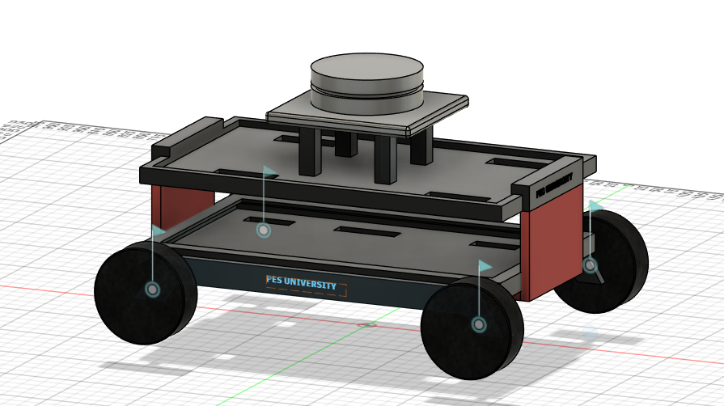
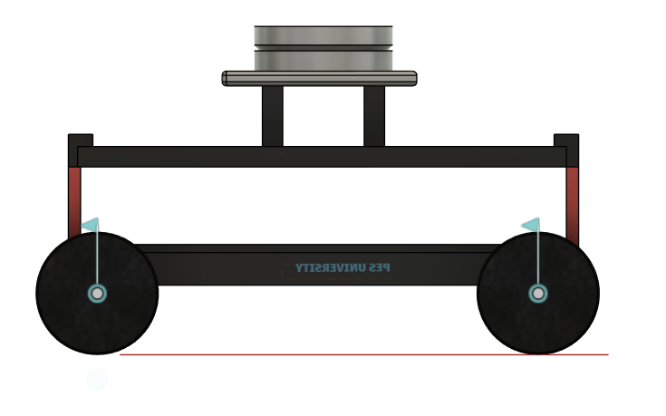
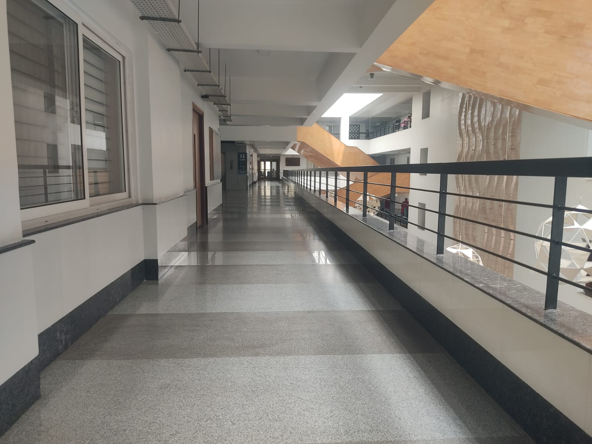
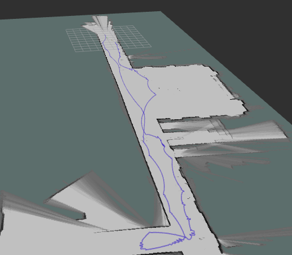

# 🤖 Autonomous Indoor Navigation using Cartographer SLAM | ROS 2 Humble

This project showcases a 4-wheeled indoor robot developed using **ROS 2 Humble** for autonomous indoor navigation.

It features:

- 📍 **Real-time 2D SLAM** using [Google Cartographer](https://google-cartographer.readthedocs.io/)
- 🧭 Autonomous path planning using the **Nav2 stack**
- 🧠 Trajectory control via the **Vector Pursuit Controller**
- 🌐 Real-time LiDAR scanning using the **YDLidar X4 Pro**
- 🛠️ Motor control with **Arduino UNO + L298N Motor Driver**

The system was tested successfully in simulation, demonstrating full autonomous exploration.

> ⚠️ On the real robot, full autonomy was partially implemented due to hardware tuning and control issues.

Developed as part of a **2025 Internship Project at PES University**, under the guidance of **Dr. Ashok Kumar Patil, Professor, PES University**.

---

## 🚀 Features

- 🗺️ Real-time 2D SLAM using Cartographer
- 🤖 Nav2-based autonomous navigation
- 🌈 Smooth trajectory following with Vector Pursuit Controller
- 📡 YDLidar X4 Pro laser scanner integration
- 🧩 Arduino UNO + Serial Motor Driver control
- 🧪 Simulation and real-world testing
- 🛠️ CAD robot design and demonstration video

---

## 🖼️ Robot Model (CAD)

<table>
  <tr>
    <td align="center">
      
      <br/>
      <b>🔹 Front Isometric View</b>
    </td>
    <td align="center">
      
      <br/>
      <b>🔸 Side Elevation View</b>
    </td>
  </tr>
</table>

📐 Designed in **Fusion 360** as part of our UGV prototype during the internship at PES University.

---

## 🛰️ Real-World Mapping Results

### 🔹 Corridor Environment (Real World)

<p align="center">
  
</p>

*The test was conducted in a corridor on PES University's 11th floor. The robot navigated this environment using its onboard LiDAR sensor and localization system.*

### 🔹 Real-Time SLAM & Robot Trajectory

<p align="center">
  
</p>

*The map was generated using Google Cartographer SLAM. The blue trajectory represents the robot's movement during autonomous mapping.*

---

## 🌐 LiDAR Point Cloud Visualization

### 3D Environment Representation

The onboard **YDLidar X4 Pro** was integrated with ROS 2 to collect real-time 2D laser scan measurements of the surrounding indoor environment.

These measurements were processed using Google Cartographer SLAM to support environmental mapping and robot localization.

The following visualization illustrates the relationship between a real-world indoor corridor, a 3D point-cloud representation and the corresponding occupancy-grid mapping concept.

<p align="center">
  
</p>

**Visualization highlights:**

- 🔹 Spatial representation of the indoor corridor.
- 🔹 Height-based colour visualization of 3D point-cloud structures.
- 🔹 Identification of environmental structures such as walls, floors, windows and railings.
- 🔹 Occupancy-grid mapping generated using Cartographer SLAM.
- 🔹 Visualization of the robot's mapping trajectory.

> ⚠️ **Technical clarification:** The YDLidar X4 Pro is a 2D LiDAR sensor. The 3D point-cloud views above are illustrative representations of how a 3D LiDAR dataset can look. They are not direct PCD/PLY exports from the project's 2D LiDAR sensor. The actual project mapping result is shown in the Real-World Mapping Results section above.

---

## 💻 Requirements

### Software

- Ubuntu 22.04
- ROS 2 Humble
- Python 3
- Arduino IDE
- Google Cartographer
- Nav2
- RViz2

### Hardware

- 🔌 Arduino UNO
- ⚙️ L298N Motor Driver
- 📡 YDLidar X4 Pro (2D LiDAR)
- 🔋 Power Supply
- 💻 Laptop running Ubuntu 22.04 + ROS 2 Humble
- 🍓 Raspberry Pi 4 (optional for edge deployment)

---

## 🧠 Vector Pursuit Controller

This project integrates the [**Vector Pursuit Controller**](https://github.com/blackcoffeerobotics/vector_pursuit_controller) plugin into the **ROS 2 Nav2 stack** to enable smooth and accurate path tracking.

The controller tracks path orientation in a geometrically meaningful way and provides an efficient, low-latency and lightweight approach to trajectory following.

### 📢 Credits

- 🧪 The **Vector Pursuit Controller** is developed and maintained by [Black Coffee Robotics](https://github.com/blackcoffeerobotics).
- 🏫 Special thanks to **PES University** for providing hardware access, laboratory facilities and technical mentorship throughout the internship project.

---

## 📦 Get Started

### 1. Install ROS 2 Dependencies

```bash
sudo apt update

sudo apt install \
  ros-humble-cartographer \
  ros-humble-navigation2 \
  ros-humble-nav2-bringup \
  ros-humble-vector-pursuit-controller \
  ros-humble-rviz2
```

### 2. Clone the Repository and Build

```bash
git clone https://github.com/ASN07S/pesu_iot_ws.git

cd pesu_iot_ws

mkdir -p src

# Move packages into src if not already there

colcon build --symlink-install

source install/setup.bash
```

### 3. Launch Components for Mapping (Real UGV)

**Step 1: Run YDLidar Driver**

```bash
ros2 launch ydlidar_ros2_driver ydlidar_launch.py
```

**Step 2: Launch Cartographer SLAM**

```bash
ros2 launch ydlidar_ros2_driver ydlidar_cartographer_launch.py
```

**Step 3: Save the Generated Map**

```bash
ros2 run nav2_map_server map_saver_cli -f ~/your_map
```

### 4. Launch Components for Autonomous Navigation (Real UGV)

**Step 1: Run YDLidar Driver**

```bash
ros2 launch ydlidar_ros2_driver ydlidar_launch.py
```

**Step 2: Start Vector Pursuit Navigation**

```bash
ros2 launch vector_pursuit_navigation pesu_bot.py
```

**Step 3: Start Arduino Serial Bridge**

```bash
ros2 run nav2_arduino_bringup arduino_odometry_node
```

---

## 🎯 Project Outcome

This project provided practical exposure to:

- ROS 2-based robotics development.
- LiDAR sensor integration and 2D laser scanning.
- SLAM-based mapping and localization.
- Autonomous navigation using Nav2.
- Trajectory tracking and motion control.
- Embedded hardware integration using Arduino.
- Simulation and real-world robotics testing.

The project demonstrates the integration of robotics software, sensor technologies and embedded systems to develop an autonomous indoor navigation platform.
